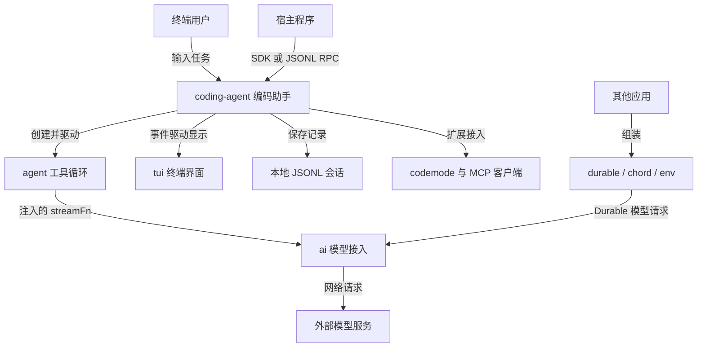
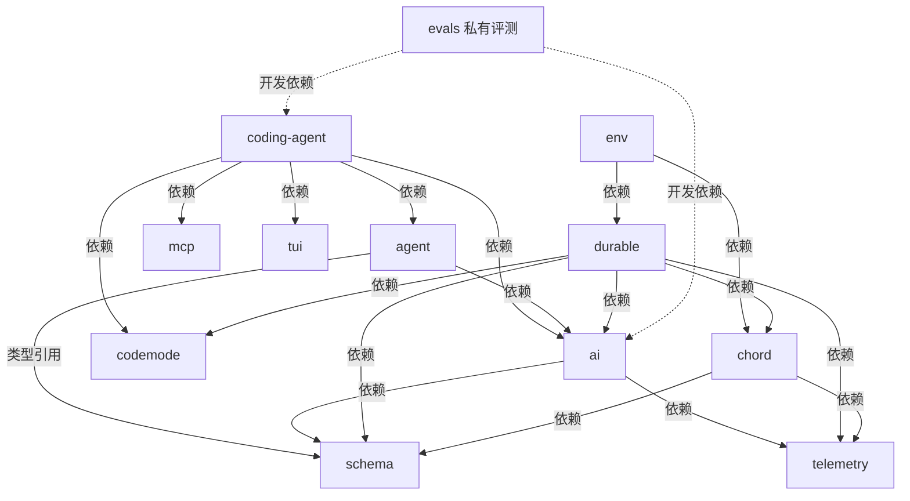
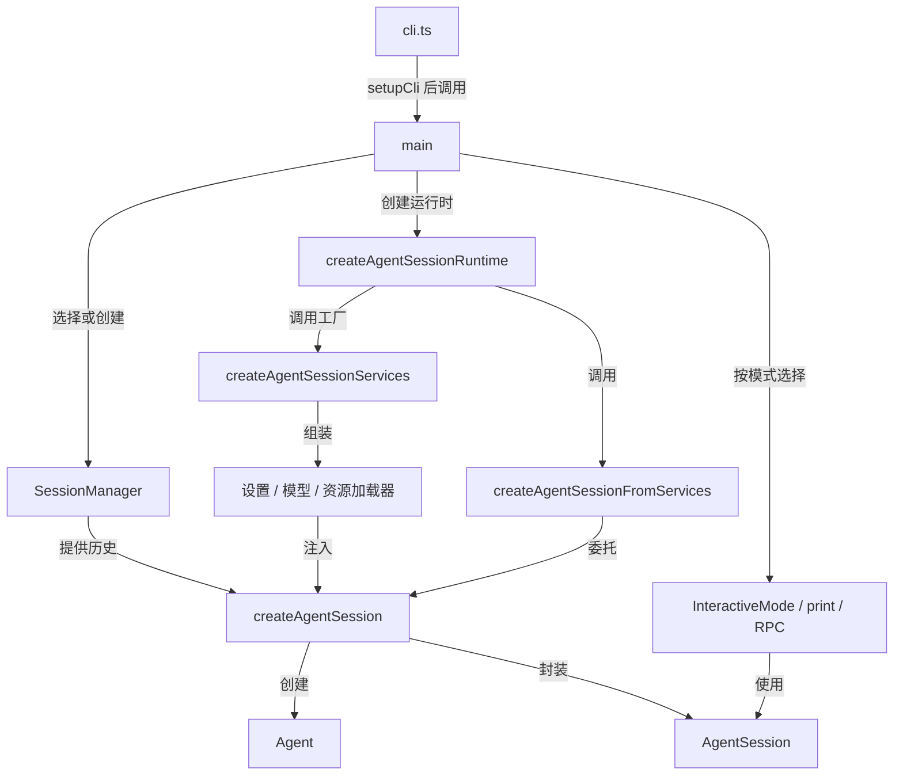
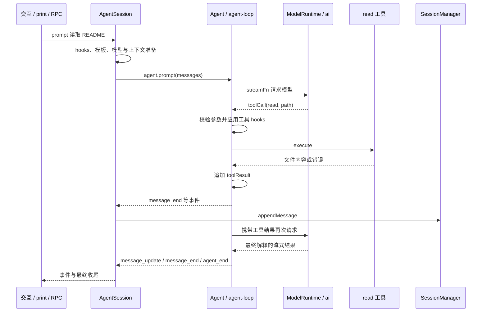
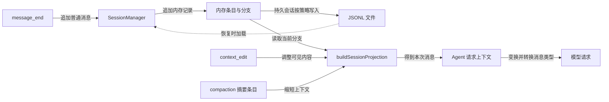
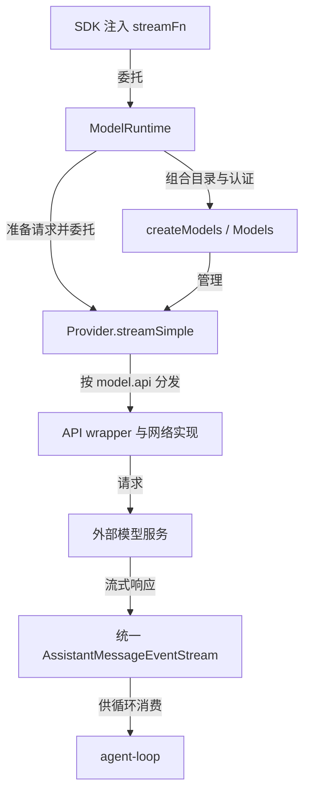
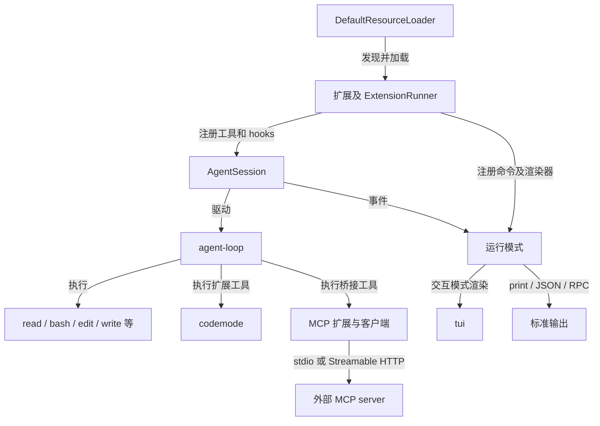
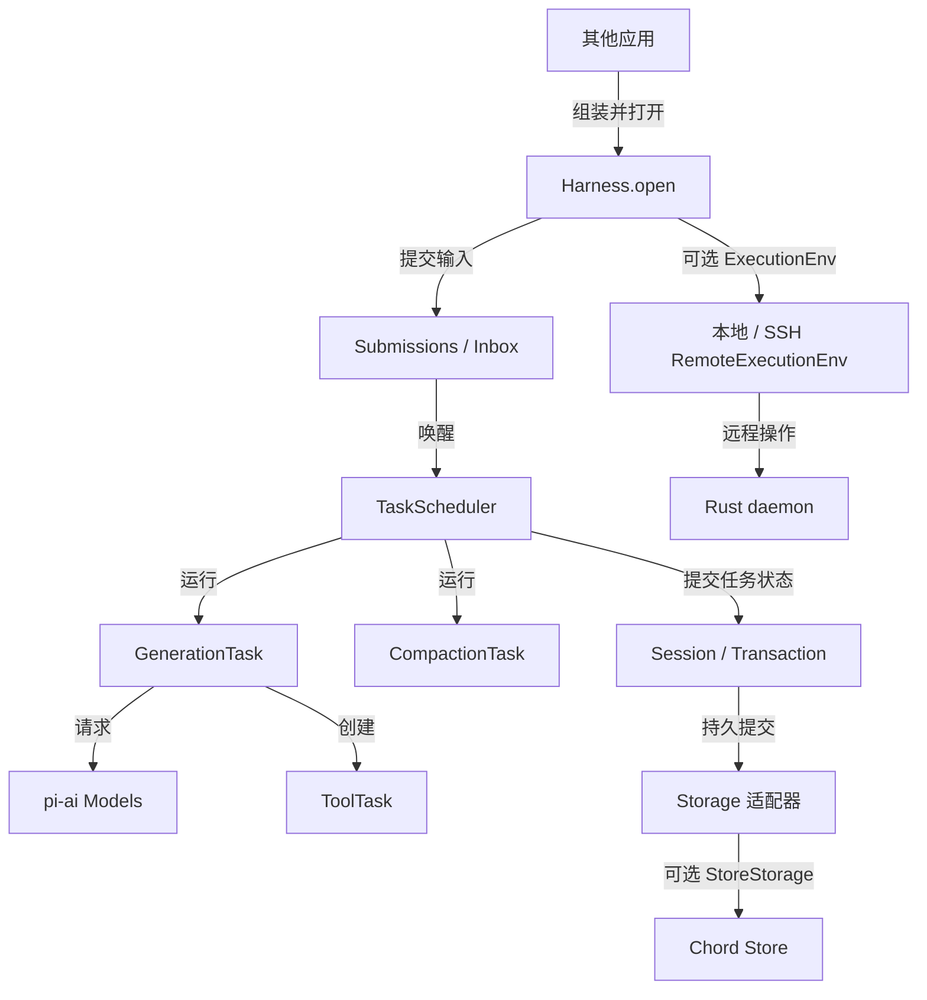
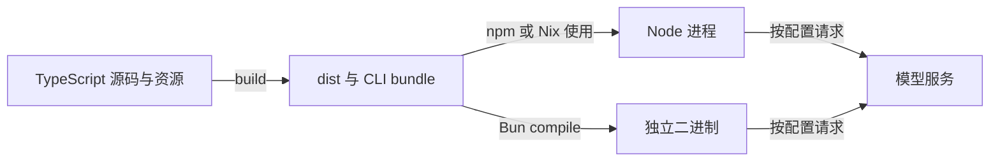
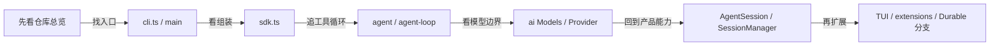

# Architecture Diagrams

Pi 中文架构图。基线：`5d74f40de919742b5847eb2da4b023d048987689`。可视化阅读入口：[中文图解](docs/learning/pi/pi-architecture.html)。

先区分三种箭头：**依赖**表示 package.json 的安装声明；**调用**表示已核对的源码调用；**事件**表示结果通知。包依赖不等于每次请求都会执行。

## 一、系统总览

目的：认识 CLI 产品和应用运行库两条分支。置信度：高。省略细部基础依赖，完整声明见第二图。

依据：CLI 入口与模式见 [main.ts](packages/coding-agent/src/main.ts)；创建循环见 [sdk.ts](packages/coding-agent/src/core/sdk.ts)；事件持久化见 [agent-session.ts](packages/coding-agent/src/core/agent-session.ts)；Durable 请求模型见 [generation.ts](packages/durable/src/harness/generation.ts)。最后一组不表示 CLI 默认启用这些运行库。

## 二、全部顶层包的直接依赖

目的：覆盖全部顶层包。实线箭头均为 dependencies，虚线为 devDependencies；这张图不表示运行次序。置信度：高。

依据：全部 12 个顶层包 manifest，机器清单见 [inventory.json](docs/learning/pi/inventory.json)。agent 对 schema 的直接源码 import 是类型引用；类型在运行时被擦除，参数校验实际经 ai/utils/validation 进入 schema。四个嵌套扩展示例 workspace 单独列在 [SUMMARY](docs/learning/pi/SUMMARY.md)，没有混入产品包图。

## 三、启动时如何组装

目的：找出“谁创建谁”。置信度：高。省略管理命令、首次设置和错误分支。

依据：[cli.ts](packages/coding-agent/src/cli.ts)、[main.ts](packages/coding-agent/src/main.ts)、[services](packages/coding-agent/src/core/agent-session-services.ts)、[SDK](packages/coding-agent/src/core/sdk.ts)。服务创建时使用已经确定的会话工作目录，以避免恢复会话后仍沿用另一个目录的配置和资源。

## 四、一次读取文件任务的时序

目的：解释一次输入为何可产生多次模型请求。置信度：高。read 是所选工具已启用时的示例；扩展可能改写或接管输入。

依据：[AgentSession.prompt / _startRun](packages/coding-agent/src/core/agent-session.ts)、[runLoop / executeToolCalls](packages/agent/src/agent-loop.ts)、[read](packages/coding-agent/src/core/tools/read.ts)。message_end 的持久化适用于普通消息；特殊条目有自己的处理路径。图中只展开一组事件，不表示用户消息和最终模型消息不保存。

## 五、会话记录怎样变成模型上下文

目的：区分磁盘历史和模型看到的消息。置信度：高。

依据：[session-manager.ts](packages/coding-agent/src/core/session-manager.ts)、[AgentSession 的请求投影与压缩](packages/coding-agent/src/core/agent-session.ts)。投影从 SessionManager 的内存条目构建，不是每次请求重新读 JSONL。inMemory 会话不写磁盘。压缩改变后续请求上下文，不等于删除全部原始记录。

## 六、模型接入的内部展开

目的：理解 Models、Provider、API 实现的职责。置信度：高。每个提供商的认证、请求和惰性加载细节不同。

依据：[model-runtime.ts](packages/coding-agent/src/core/model-runtime.ts)、[models.ts](packages/ai/src/models.ts)、[OpenAI provider 示例](packages/ai/src/providers/openai.ts)。旧全局注册器属于 [compat.ts](packages/ai/src/compat.ts)，没有把它画成新根入口必须经过的节点。

## 七、扩展、MCP 与终端显示

目的：定位扩展点，区分模型工具、外部工具服务和 UI。置信度：高。

依据：[扩展 API](packages/coding-agent/src/core/extensions/types.ts)、[内置扩展入口](packages/coding-agent/src/extensions/index.ts)、[MCP 客户端](packages/mcp/src/client.ts)、[运行模式](packages/coding-agent/src/modes/index.ts)。可用工具不等于全部启用；RPC 自定义 UI 的支持范围也不同于 TUI。

## 八、Durable 与 Chord 的进阶分支

目的：解释另一组运行库，避免混入 CLI SessionManager。置信度：高。存储适配、ExecutionEnv 和 Chord 集成由应用选择。

依据：[harness](packages/durable/src/harness/harness.ts)、[任务 registry](packages/durable/src/harness/registry.ts)、[StoreStorage](packages/durable/src/storage/store/storage.ts)、[RemoteExecutionEnv](packages/env/src/remote-env.ts)。这张图没有声称 Chord 设计文档中的目标集成示例已经接入 CLI，也没有验证远程端到端运行。

## 九、运行产物与阅读路线

置信度：高。构建图表示产生可执行产物，阅读图表示教学顺序，两者都不是用户请求时序。

依据：[根构建脚本](package.json)、[coding-agent 构建脚本](packages/coding-agent/package.json)、[Nix](nix/package.nix)。evals Docker 是评测环境，未画成 CLI 必需服务。

阅读时配合 [TypeScript 中文注释](docs/learning/pi/TYPESCRIPT.md)，不要一开始就顺目录通读所有提供商、平台适配和旧版 Chord。
