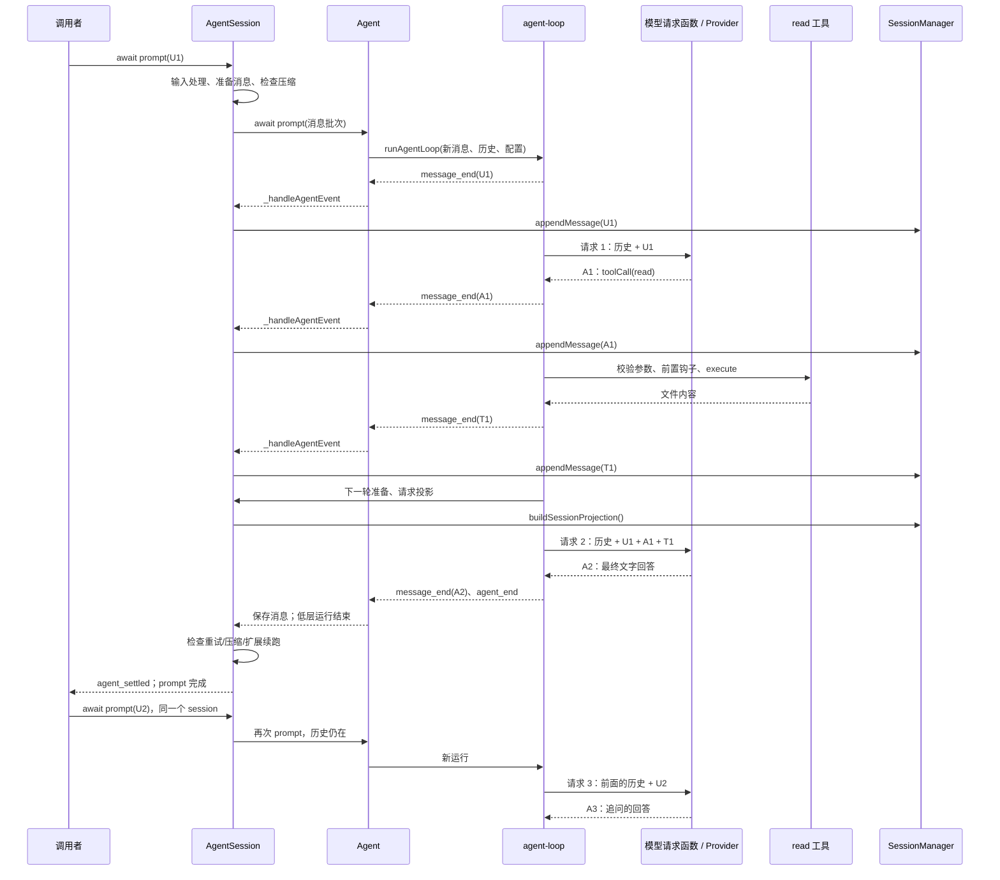

# 从两句提问读懂 Pi：模型、工具、历史与事件

这份导读对应学习分支 `learning/full-chain-study-bay`。先从 SDK 的 `session.prompt()` 读起，沿着同一个问题走到模型、真实文件读取、工具结果回传和第二句追问。

**先记住：模型输出“我要调用 read”，Pi 执行 read；执行结果再发给模型，模型才能根据文件内容回答。** 一次用户提问通常不止一次模型请求。

配套源码的中文注释覆盖本主链的入口、调度、请求边界、工具执行和事件保存。在大文件中按函数范围注释；没有把整份 `agent-session.ts` 的树导航、导出、其他工具等旁支逐行展开。纯括号、空行不重复解释。供应商网络实现是后续阅读边界，下面给出真实入口，不把它们混入本次逐行范围。

## 1. 先运行一个确定的例子

学习测试：[query-call-chain-learning.test.ts](../../../packages/coding-agent/test/suite/query-call-chain-learning.test.ts)。里面有中文逐行说明，可以作为第一个断点入口。

在仓库根目录运行：

```sh
cd packages/coding-agent
node ../../node_modules/vitest/dist/cli.js --run test/suite/query-call-chain-learning.test.ts
```

测试创建临时文件 `decision.txt`，内容是：

```text
决定：使用 TypeScript。原因：需要类型检查。
```

接着执行两句用户输入：

```ts
// 同一个 session 连续提问；第二句自然带上第一句的历史。
await session.prompt("读取 decision.txt，告诉我项目的决定和原因。");
await session.prompt("用一句话重述刚才的决定。");
```

实际轨迹如下。`U` 是用户消息，`A` 是模型消息，`T` 是工具结果；表中省略 system 消息和提示词补丁。

| 时点 | 模型收到的消息 | 本次输出/动作 |
| --- | --- | --- |
| Query 1，模型请求 1 | `U1` | 模型输出 `read({path:"decision.txt"})`，成为 `A1` |
| Pi 执行工具 | 无新的模型请求 | 真正读取文件，生成 `T1` |
| Query 1，模型请求 2 | `U1 → A1 → T1` | 模型根据文件回答，成为 `A2` |
| Query 2，模型请求 3 | `U1 → A1 → T1 → A2 → U2` | 模型根据历史回答追问，成为 `A3` |

**两句用户问题、三次模型请求、一次文件读取。** 内部续轮没有伪造新的用户输入。

这里的模型是 **faux provider**：你预先排好它三次要返回的内容，它仍会产生模型流事件。文件读取、Agent 循环、消息转换、工具钩子、会话投影和事件保存走实际实现。这样可以重复下断点，不需要真实 API Key，也不会随机决定调用哪个工具。

测试使用 `SessionManager.inMemory()`，验证的是会话内存记录。它没有验证重启恢复、磁盘 JSONL 写入、真实模型的判断能力、真实网络请求、供应商计费或 prompt cache 命中率。

如果新克隆仓库缺少生成数据或 `dist/`，先在仓库根目录按官方命令准备：

```sh
# 这一步要联网，下载 gitignored 的模型目录数据；不会调用聊天模型。
npm run hydrate:model-data
# 用本地已有目录数据构建各包，不重新拉上游目录。
npm run build:offline
```

## 2. 一图看清前后两条链



上面画了工具结果的保存，最终文字回答同样在 `message_end` 时保存。真实流会有许多 `message_update`，图中省略这些中间事件。

`AgentSession` 的意思是“会话管理层”；`Agent` 是“带状态的运行器”；`agent-loop` 是“不断请求模型、执行工具的循环”。三层职责不同，但处理的是同一条用户请求。

## 3. 初始化只做一次，prompt 可以做很多次

入口：[sdk.ts](../../../packages/coding-agent/src/core/sdk.ts) 的 `createAgentSession()`。

```text
createAgentSession(options)
  ├─ 创建/复用 ModelRuntime：模型、供应商、认证
  ├─ 创建/复用 SettingsManager：配置
  ├─ 创建/复用 SessionManager：历史、分支、保存
  ├─ ResourceLoader.reload()：默认加载器下加载技能、扩展、项目规则等
  ├─ 恢复已有消息，选择模型、思考级别、工具
  ├─ new Agent({ streamFn, convertToLlm, transformContext, ... })
  └─ new AgentSession({ agent, sessionManager, ... })
       ├─ agent.subscribe(_handleAgentEvent)：接上消息保存
       ├─ 安装 beforeToolCall / afterToolCall
       ├─ 安装 prepareNextTurnWithContext：回合间刷新/压缩
       ├─ 安装 prepareRequest：每次请求前投影有效历史
       └─ 构建扩展运行器、工具注册表和 system 提示词
```

`streamFn: async (...) => {...}` 是把函数放进配置，叫**依赖注入**：上层决定用谁请求模型，Agent 以后再调用。定义箭头函数不等于立即执行模型请求。

不要每次提问都新建 session。你若希望第二句知道第一句发生了什么，就复用同一个 session；如需跨进程恢复，则依靠会话保存和恢复入口，而不是依赖模型服务器自动记住历史。

## 4. 一句 query 的真实函数栈

### A. 接受用户问题，准备输入

文件：[agent-session.ts](../../../packages/coding-agent/src/core/agent-session.ts)。

```text
AgentSession.prompt(text, options)
  ├─ 扩展斜杠命令：可能直接处理并返回，不请求模型
  ├─ _runInputHandlers()：扩展可以处理或改写输入
  ├─ _expandSkillCommand() / expandPromptTemplate()：展开技能/模板
  ├─ 正在运行？按 streamingBehavior 排进 steer / followUp 队列
  ├─ 检查选中模型、认证
  └─ _startRun({messageType:"user", prompt:text, images})
       ├─ _prepareRun()
       │    ├─ _checkCompaction()：必要时先压缩旧历史
       │    ├─ emitBeforeAgentStart()：扩展可改本次规则、模型等
       │    ├─ _normalizePromptImages()：处理图片，无图片则返回空列表
       │    ├─ 构造 role:user 的消息
       │    └─ _preparePromptAndToolLoadout()：生成必要的 system 补丁
       └─ await agent.prompt(messages)
```

为什么有两个 `prompt()`：会话层懂技能、配置、保存、压缩；低层 Agent 只需要标准消息、工具和模型函数。把 `/skill:xxx` 这样的应用输入直接塞进低层 Agent，它不会自动完成这些应用层展开。

### B. 建立本次低层运行

文件：[agent.ts](../../../packages/agent/src/agent.ts)。

```text
Agent.prompt(input)
  ├─ normalizePromptInput()：字符串/单消息/消息数组统一成数组
  └─ runPromptMessages(messages)
       └─ runWithLifecycle(executor)
            ├─ 建 AbortController、activeRun，标记运行中
            └─ 执行 executor(signal)
                 └─ runAgentLoop(
                      messages,                 // 本次新输入
                      createContextSnapshot(),  // 已有历史 + 可执行工具
                      createLoopConfig(),       // 模型、钩子、队列等
                      event => processEvents(event),
                      signal,
                      streamFunction            // 初始化时注入的请求函数
                    )
```

**这里调用的是 `runAgentLoop()`。** 同文件还有 `agentLoop()`，它是返回 `EventStream` 的另一层包装；当前 `Agent.prompt()` 主线不需要先经过它。读源码时不要仅凭相似函数名把两条入口串在一起。

### C. 请求一次模型，并接收流

文件：[agent-loop.ts](../../../packages/agent/src/agent-loop.ts)。

```text
runAgentLoop()
  ├─ declareToolChanges()：声明实际工具相对于历史的变化
  ├─ 发 agent_start / turn_start / 起始消息事件
  └─ runLoop()
       ├─ 后续回合：prepareNextTurn() → 会话刷新/压缩
       ├─ prepareRequest() → 会话投影、可选模型路由
       └─ streamAssistantResponse()
            ├─ transformContext()：扩展/会话对本次请求消息做变换
            ├─ convertToLlm()：转成模型认识的消息
            ├─ normalizeContext()：规范请求上下文
            ├─ 解析 getApiKey（如果配置了）
            ├─ await streamFunction(model, context, options)
            └─ for await (...) 消费模型流
                 ├─ start → message_start
                 ├─ text/thinking/toolcall 增量 → message_update
                 └─ done/error → 最终 AssistantMessage → message_end
```

`convertToLlm()` 是格式转换，不是摘要压缩，也不是网络请求。`message_update` 是一条消息的累计草稿更新；例如“使用”再变成“使用 TypeScript”，历史不应因此多出两条 assistant 消息。

生产 SDK 的请求函数继续走：

```text
sdk.ts 中注入的 streamFn
  ├─ buildRequestOptions()：实时超时、重试、请求头钩子等
  ├─ 根据策略登记缓存保温目标
  └─ ModelRuntime.streamSimple()                         core/model-runtime.ts
       └─ lazyStream 的异步启动回调
            ├─ prepareRequest()
            │    ├─ models.getProvider(model.provider)  取具体供应商
            │    └─ getAuth()、请求头、baseUrl、环境配置
            └─ prepared.provider.streamSimple(...)      进入供应商实现
```

见 [model-runtime.ts](../../../packages/coding-agent/src/core/model-runtime.ts)。普通物理模型走以上分支；虚拟模型会先路由到物理模型。供应商再负责协议、请求体、HTTP/WebSocket 和流解析。不同供应商有不同实现，不能画成全都调用同一个 `fetch()` 函数。

**当前这条 SDK 路径并不调用 `Models.streamSimple()`。** `ModelRuntime` 用 Models 获取 Provider 和相关配置，然后直接调用 Provider。Pi-ai 对外提供的 `Models.streamSimple()` 是另一条可以独立使用的入口。

学习测试的 [harness.ts](../../../packages/coding-agent/test/suite/harness.ts) 直接装配 `AgentSession`，注入 compat 的 `streamSimple`，由 faux provider 回答。它没有运行 SDK 的资源发现、模型恢复和缓存保温装配。SDK 主线与测试共享会话运行和工具循环，供应商入口不同。

### D. 模型要求工具时，Pi 执行工具

```text
runLoop() 收到完整 assistant 消息
  └─ 发现 content 中有 type:toolCall
       └─ executeToolCalls()
            ├─ 配置/工具要求串行 → executeToolCallsSequential()
            └─ 默认 → executeToolCallsParallel()
                 ├─ prepareToolCall()
                 │    ├─ 按 name 找已注册工具
                 │    ├─ prepareToolCallArguments()
                 │    ├─ validateToolArguments()：按 schema 校验模型参数
                 │    └─ beforeToolCall() → AgentSession._beforeToolCall()
                 ├─ executePreparedToolCall()
                 │    └─ prepared.tool.execute(...)
                 ├─ finalizeExecutedToolCall()
                 │    └─ afterToolCall() → AgentSession._afterToolCall()
                 ├─ emitToolExecutionEnd()
                 ├─ createToolResultMessage()
                 └─ emitToolResultMessage() → message_start / message_end
```

并行模式有两个容易漏掉的细节：准备/前置检查按顺序执行，真正工具任务随后并发启动；最终 `toolResult` 消息仍按模型调用顺序发布，不按工具完成速度排序。

模型 JSON 是外部输入，`path: string` 这类 TS 类型只在开发时存在，不能验证模型实际回了什么。因此 schema 校验必要。校验失败、工具找不到、前置钩子阻止、工具抛异常等通常会变成错误 `toolResult`，让模型在下一轮看到原因。若 assistant 因输出长度上限截断，Pi 不执行里面可能不完整的工具参数。

### E. read 究竟在哪里读文件

`AgentSession` 创建内置工具定义，并通过包装器提供执行上下文。不是必须先调用 `createReadTool()` 这个独立适配工厂才可读取文件。

```text
装配时：createAllToolDefinitions()
  → createReadToolDefinition(cwd, options)
  → wrapRegisteredTools() → wrapRegisteredTool()
  → wrapToolDefinition(definition, ctxFactory)
  → Agent.state.tools 中的 read

执行时：prepared.tool.execute(id, args, signal, onUpdate)
  → wrapToolDefinition 返回的转发函数
  → runner.createToolContext(id, signal)
  → definition.execute(..., ctx)                  read.ts 中的 async execute
       ├─ resolveReadPathAsync()：定位绝对路径
       ├─ ops.access()：确认可读
       ├─ 检测图片，图片则走 processImage()
       └─ 文本文件：ops.readFile()                 默认是真正的 fs/promises.readFile
            ├─ Buffer.toString("utf-8")：字节变文字
            ├─ 按 offset / limit 选行
            ├─ truncateHead()：工具输出行数/字节上限
            └─ 返回 {content, details, structuredContent}
```

源码：[read.ts](../../../packages/coding-agent/src/core/tools/read.ts)、[wrapper.ts](../../../packages/coding-agent/src/core/extensions/wrapper.ts)、[tool-definition-wrapper.ts](../../../packages/coding-agent/src/core/tools/tool-definition-wrapper.ts)。

例如 `offset:11, limit:5` 代表取第 11～15 行；内部数组下标从 0 开始，所以先用 `offset - 1`。工具输出过长时，返回“用 offset 继续读取”的提示。

**工具输出截断与会话压缩不同。** `truncateHead()` 是本地按行/字节裁剪某次文件结果；会话压缩是处理整段历史，默认会调用模型生成摘要。两者在请求链中的位置不同。

### F. 工具结果交回模型，直到结束

```text
executeToolCalls...() 返回本批 toolResult
  → runLoop() 追加到 currentContext.messages / newMessages
  → finishTurn() / turn_end
  → 读取 steer 队列
  → 继续内层循环
  → prepareNextTurn() / prepareRequest()
  → streamAssistantResponse() 再请求一次模型
  → 模型这次输出普通文字，没有 toolCall
  → 没有插话，再看 follow-up 队列/显式继续决策
  → 没有后续，发 agent_end
  → Agent.runWithLifecycle 的 finally：finishRun()
  → 返回 AgentSession._startRun()
       ├─ _handlePostAgentRun()：重试、溢出恢复、自动压缩、排队消息
       ├─ _runBeforeSettleBoundary()：扩展可能要求继续
       └─ finally → _emitAgentSettled()
  → 最初的 await session.prompt(...) 完成
```

`await session.prompt()` 在普通空闲提问路径上等整个会话运行。函数返回 `Promise<void>`，不直接返回最终文本：通过 `session.subscribe()` 观察流事件，或完成后调用 `session.getLastAssistantText()` 取文字。

忙碌时用 `streamingBehavior` 提交的 prompt 只负责排队，其返回不表示排队消息已获得回答。`agent_end` 是低层运行结束事件，会话还可能重试/压缩；`agent_settled` 是更外层的收尾通知。扩展也能在 settled 通知期间再提交后续任务，因此观察事件时还要结合自己的任务协议。

## 5. 反向追踪：谁保存了消息

```text
agent-loop 发出 emit({type:"message_end", message})
  → Agent.processEvents(event)
       ├─ 先把完整消息追加到 Agent._state.messages
       └─ 逐个 await listener(event, signal)
            → AgentSession._handleAgentEvent(event)
                 ├─ await _emitExtensionEvent(event)：允许扩展替换消息
                 ├─ _emit(event)：通知公开订阅者
                 └─ SessionManager.appendMessage(message)
                      → _appendEntry()：更新内存条目/索引/当前叶子
                      → _persist()：持久模式下写 JSONL
```

原始会话条目组成一棵带 parentId 的树。模型请求使用的是**投影**：沿当前分支，把压缩、上下文编辑等规则应用后得到的消息。原始记录与模型这次能看到的内容不必完全一样。

见 [session-manager.ts](../../../packages/coding-agent/src/core/session-manager.ts) 的 `appendMessage()`、`_appendEntry()`、`_persist()`、`buildSessionProjection()`。本次没有给这份通用会话存储文件全文加注释。

一个重要时序：公开 `message_end` 订阅回调在该事件的 `appendMessage()` **之前**执行，不能在这个公开回调中假定 SessionManager 已保存了当前消息。但整个内部 `emit()` 会等待会话监听器处理完，所以正常下一次模型请求开始前，对应工具结果已经保存。配套测试在第二次请求中验证这一点。

## 6. 第二句问题为什么记得第一句

第二次还是走同一套 `AgentSession.prompt → Agent.prompt → runAgentLoop`。变化只有输入和已有历史：

```text
第一次完成后：Agent.state.messages 中有 U1 / A1 / T1 / A2
第二次 prompt：新消息是 U2
createContextSnapshot()：带上旧历史
runAgentLoop()：旧历史 + U2
prepareRequest()：再以 SessionManager 当前有效投影为准
streamAssistantResponse()：把这份历史明确发送给模型
```

因此模型不需要在服务器“记住上一次请求”。上下文由客户端每次组织发送。历史过大时，会话层可以把旧部分换成摘要，仍按相同请求链发送。这正是之前讨论 Topic 压缩方案可以介入的地方：摘要怎么组织是一层策略，模型/工具循环是另一层执行机制。

排队输入又分两种：`steer` 在当前模型回合及工具完成后、下次模型请求前投递；`followUp` 在低层自然准备结束时投递。两者都不意味着立即打断一半的模型输出并执行新问题。

## 7. 函数职责速查

| 文件/函数 | 输入 | 核心工作 | 输出或影响 |
| --- | --- | --- | --- |
| `sdk.ts / createAgentSession` | 创建选项 | 装配模型、日志、资源、Agent、会话 | `{session, ...}` |
| `AgentSession.prompt` | 用户文字、附件、派发方式 | 输入拦截、展开、排队或启动 | `Promise<void>` |
| `_startRun` | 用户/custom 触发信息 | 管理一次会话运行，包含后续重试/收尾 | 最终 settled |
| `_prepareRun` | 触发信息 | 压缩检查、before_agent_start、构造新消息 | `AgentMessage[]` |
| `Agent.prompt` | 字符串或消息 | 统一输入，启动低层运行 | `Promise<void>` |
| `normalizePromptInput` | 多种合法输入 | 统一成消息数组 | 新消息数组 |
| `runPromptMessages` | 新消息 | 接上上下文、配置、事件回调、请求函数 | 等待循环完成 |
| `runWithLifecycle` | 执行回调 | activeRun、取消、异常、finally 清理 | 低层运行完成 |
| `createContextSnapshot` | Agent 状态 | 浅复制历史和工具数组 | `AgentContext` |
| `createLoopConfig` | Agent 设置/钩子 | 组装回调和队列读取器 | `AgentLoopConfig` |
| `runAgentLoop` | 新消息、旧上下文、配置 | 发起始事件，进入共用循环 | 本次新增消息 |
| `runLoop` | 当前上下文/配置 | 调度模型、工具、插话和追问 | 持续更新历史/发事件 |
| `streamAssistantResponse` | 请求上下文 | 转换消息、调用模型、消费流 | 完整 assistant 消息 |
| SDK 注入的 `streamFn` | 模型、模型消息、请求选项 | 合并实时设置，调用 ModelRuntime | 模型事件流 |
| `ModelRuntime.streamSimple` | 模型、上下文、选项 | 认证与供应商分派 | 模型事件流 |
| `executeToolCalls` | assistant 中的工具调用 | 选择串行/并行 | 一批工具结果消息 |
| `prepareToolCall` | 单次工具声明 | 查工具、参数校验、前置拦截 | 可执行调用或立即失败结果 |
| `executePreparedToolCall` | 已校验工具与参数 | 真正调用 execute，等待进度通知 | 结果、错误标志、耗时 |
| `finalizeExecutedToolCall` | 工具原始结果 | 后置钩子覆盖与收尾 | 最终工具结果 |
| read 的 `execute` | path/offset/limit 等 | 真读文件，选行、图片处理、输出截断 | 工具 content/details 等 |
| `createToolResultMessage` | 最终工具结果 | 包装角色与调用 id | `ToolResultMessage` |
| `processEvents` | Agent 事件 | 更新运行状态，等待监听器 | 状态/监听器副作用 |
| `_handleAgentEvent` | Agent 事件 | 扩展、公开通知、完整消息保存 | 会话条目与外部事件 |
| `buildSessionProjection` | 会话分支、编辑/压缩规则 | 得到当前有效历史 | 请求使用的消息投影 |

## 8. 沿着这条链顺便学 TypeScript

不必先学完语言再读代码。先认识这些本链反复出现的语法：

```ts
// 1. 类型标注：冒号后面是类型，不是一个运行时值。
const names: string[] = ["read", "bash"];

// 2. 联合类型：允许几种明确的形状之一，不是同时拥有全部字段。
type Input = string | { role: "user"; content: string };

// 3. 可选参数：options 可以不传；?. 不存在时跳过，?? 只在空缺时用默认值。
function choose(options?: { enabled?: boolean }): boolean {
  return options?.enabled ?? true; // enabled=false 时仍是 false。
}

// 4. async 返回 Promise；await 等结果，但不会把线程卡死到不能处理其他异步工作。
async function ask(): Promise<void> {
  await session.prompt("你好");
}

// 5. 回调：传的是函数，接收方以后再调用；这是 streamFn、emit、工具钩子的基础。
const onEvent = (event: { type: string }) => console.log(event.type);

// 6. 展开：先保留原字段，再覆盖；数组展开则逐个取出数组元素。
const request = { ...oldRequest, messages: [...oldMessages, newMessage] };

// 7. 解构与改名：取对象 text 字段，存成 currentText。
const { text: currentText } = processedInput;

// 8. 带标签的联合类型：先检查 kind，TS 就能知道接下来能访问哪个字段。
type Preparation = { kind: "prepared"; args: unknown } | { kind: "immediate"; reason: string };
function explain(preparation: Preparation): string {
  if (preparation.kind === "immediate") return preparation.reason;
  return "参数准备完成";
}
```

以上片段为语法示意，`session`、`oldRequest` 等由所在程序提供，不是直接可运行的独立文件。更多基础见 [TYPESCRIPT.md](TYPESCRIPT.md)。

## 9. 推荐断点与当前注释范围

按这个顺序下断点，每停一次看右侧建议变量：

1. 学习测试第一个 `session.prompt()`：确认只有一次用户输入。
2. `AgentSession.prompt()` / `_startRun()`：看 `text`、`messages`。
3. `Agent.runPromptMessages()`：看 `this.state.messages` 和 `this.streamFunction`。
4. `runLoop()`：看 `hasMoreToolCalls`、`currentContext.messages`。
5. `streamAssistantResponse()`：看 `llmContext`，再看返回的 `message.content`。
6. `prepareToolCall()`：看 `toolCall.arguments` 和 `validatedArgs`。
7. read 的 `ops.readFile()`：看 `absolutePath`，确认真正在此读文件。
8. `createToolResultMessage()`：看 `toolCallId` 与 `content`。
9. 第二次进入 `streamAssistantResponse()`：确认历史多了 `A1 + T1`，用户消息仍只有一条。
10. 测试第二个 `session.prompt()`：确认旧历史保留，并观察第三次模型请求。

源码注释的第一版覆盖：

| 文件 | 重点范围 |
| --- | --- |
| [sdk.ts](../../../packages/coding-agent/src/core/sdk.ts) | 初始化装配、注入请求函数、创建 Agent/AgentSession |
| [agent-session.ts](../../../packages/coding-agent/src/core/agent-session.ts) | 构造接线、prompt、_startRun、_prepareRun、请求投影、回合刷新、事件保存 |
| [agent.ts](../../../packages/agent/src/agent.ts) | 输入归一化、prompt/continue、快照、循环配置、生命周期、事件更新 |
| [agent-loop.ts](../../../packages/agent/src/agent-loop.ts) | 循环、模型流处理、串并行工具管线、参数校验、结果消息 |
| [wrapper.ts](../../../packages/coding-agent/src/core/extensions/wrapper.ts) | 工具注册条目接执行上下文 |
| [tool-definition-wrapper.ts](../../../packages/coding-agent/src/core/tools/tool-definition-wrapper.ts) | 工具 execute 的转发适配 |
| [read.ts](../../../packages/coding-agent/src/core/tools/read.ts) | schema、工厂、取消、文件读取、选行与截断 |
| [学习测试](../../../packages/coding-agent/test/suite/query-call-chain-learning.test.ts) | 两句提问、三次请求、真实 read、会话记录和事件断言 |

这些是学习注释，不改变业务表达式。已有架构文档中的源码行号基于加注释前的版本，读本分支时优先按函数名定位；本导读的函数名和相对文件链接可直接用于查找。
