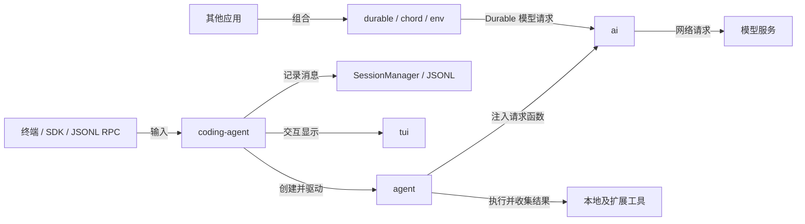

# Pi 仓库中文摘要

先打开 [架构图解](pi-architecture.html)。详细说明见 [根目录架构导读](../../../ARCHITECTURE.md)，图的可编辑文本见 [架构图源码](../../../ARCHITECTURE_DIAGRAMS.md)。本摘要基于提交 5d74f40，面向完全不熟悉仓库的读者。

## Overview

Pi 是终端编码助手，也是一组可复用的模型、agent 和应用运行库。当前 CLI 主链为 coding-agent → agent → ai；Durable、Chord 和 Env 是另一组可组合的运行库。CLI SessionManager 的本地会话持久化与 Durable Storage 是两套机制。

## Tech Stack

| 层 | 技术 | 源码依据 |
|---|---|---|
| 主要语言 | TypeScript 7.0.2、严格类型、可擦除语法 | 根 package.json、tsconfig.base.json |
| 运行时 | Node >=22.19，ESM | 各包 package.json |
| 构建 | tsc、esbuild；独立二进制使用 Bun compile | 根与 coding-agent 的 package.json |
| 代码检查 | Biome 2.3.5、tsc 和自定义检查脚本 | 根 package.json |
| 测试 | Vitest；TUI 使用 node:test | 各包 package.json |
| 可执行代码能力 | quickjs-wasi 3.6.2 | codemode/package.json |
| 远程执行 | TypeScript 客户端与 Rust daemon | env/package.json、daemon/Cargo.toml |
| 可选持久层 | 内存、JSONL、IndexedDB、Store、SQLite 等适配 | durable 的 exports 与 storage 目录 |

## Architecture

coding-agent 从终端、SDK 或 JSONL RPC 接收任务。AgentSession 处理输入、扩展、工具、上下文压缩和重试；Agent 执行通用的模型与工具循环；ModelRuntime 经 ai 的模型/提供商能力发起请求。普通消息结束事件驱动 CLI 会话记录，运行模式消费事件完成显示或输出。

### Architecture Diagram

## Module Map

全部顶层包：coding-agent、agent、ai、tui、codemode、mcp、durable、chord、env、schema、telemetry、evals。每包的一句话职责、关键文件和直接依赖见 [完整模块表](../../../ARCHITECTURE.md#6-major-components全部顶层包)；可点击探索见 [包地图](pi-architecture.html#packages)。

还有四个显式扩展示例工作区：

- with-deps：演示扩展自带依赖。
- custom-provider-anthropic：自定义提供商示例。
- custom-provider-gitlab-duo：GitLab Duo 提供商示例。
- gondolin：隔离执行环境接入示例。

它们都在 packages/coding-agent/examples/extensions；测试 fixture 或 install-lock 目录中的 package.json 不自动成为 root workspace。当前没有 apps 目录。

## API Reference

人工整理的行为入口见 [INTERFACES.md](INTERFACES.md)。声明级索引见 [public-api.tsv](public-api.tsv)；原始包清单、子路径、依赖和源码 import 证据见 [inventory.json](inventory.json)。summary.json 将相同的公开导出声明和手工分类的执行接口整理为可校验结构。

公开导出索引按各包 exports/main 发现源文件，再递归跟随星号导出，记录声明及显式重导出位置。它是静态文本索引，不展开对象方法、动态注册结果或外部库内部导出，不能代替编译器级别的完整 API 分析。

## Configuration & Environment

默认全局配置目录 ~/.pi/agent；PI_CODING_AGENT_DIR 可覆盖。包含 auth.json、models.json、settings.json、sessions。项目级设置位于 .pi/settings.json，加载受项目资源信任策略影响。模型和 MCP 外部请求使用各自支持的凭据，不要求配置所有提供商。

## Build & Deploy

npm install --ignore-scripts 安装依赖，npm run build 生成构建产物，pi-test.sh 从源码运行。build:offline 需要已有模型数据。npm、独立二进制和 Nix 是不同的分发路径；评测 Dockerfile 属于 evals。修改代码后按 AGENTS 执行 npm run check 和相关测试，完整非真实模型测试入口为 test.sh。

## Observations

- 包依赖、构建顺序、用户请求调用链是三种不同关系。
- ai 根入口是 core-only；旧全局注册行为属于 compat。
- RPC 使用标准输入输出 JSONL，不是 HTTP。
- mcp 包是客户端库；Chord 的 HTTP 能力由应用启用。
- root README 的包表和内部依赖版本说明存在与当前清单不一致之处，详见架构导读的 Validation notes。

下一步读 [两句 query 的完整调用链](QUERY_CALL_CHAIN.md)：从 `session.prompt()` 跟到模型、真实文件读取、工具结果回传和追问，配套源码有中文注释与离线测试。遇到 TypeScript 语法再查 [TypeScript 注释课](TYPESCRIPT.md)。架构扫描的验证结果与覆盖边界见 [VERIFICATION.md](VERIFICATION.md)。

整个学习分支的注释范围、逐文件状态、合并上游后的复核方式见 [覆盖与维护](STUDY_PROGRESS.md)，每批实际进度见 [维护日志](STUDY_LOG.md)。

## 后续设计讨论

[按 Topic 管理上下文与记忆的设计草案](TOPIC_MEMORY_PROPOSAL.md) 汇总主题归档、决策更新、短期与长期记忆、工具结果保留，以及固定快照和前缀缓存的取舍。它是候选方案讨论，尚未实现，不属于上述 Pi 当前架构的事实描述。
