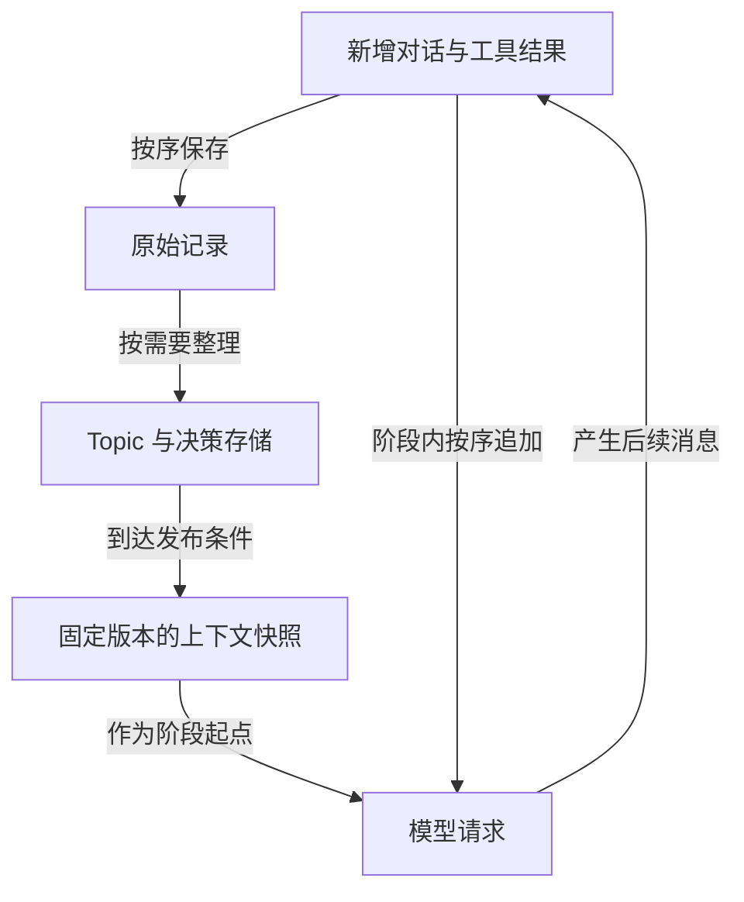

# 按 Topic 管理上下文与记忆的设计草案

状态：讨论稿。目标是评估按主题保存重要问题、用户决策和任务进展，能否让长任务更可靠地继续，同时控制整理开销和模型缓存损失。当前判断是值得继续验证，尚不能认定优于 Pi 或 Claude Code。

核心候选设计：**记忆按 Topic 持续整理，模型请求使用阶段性发布的固定快照，阶段内尽量只追加新消息。**后台记忆更新不必立即改写每次请求的前缀；影响下一步行为的决策变化必须及时生效。

本文是未来方案讨论。Pi 当前实现见 [架构导读](../../../ARCHITECTURE.md) 和 [压缩参考](../../../packages/coding-agent/docs/compaction.md)。

## 讨论目标和当前状态

用户提出的方向是：重要问题及其讨论、用户作出的决定，可以分别归档成 Topic；短期和长期记忆都可沿用这种组织方式；压缩时按 Topic 处理，并结合旧工具结果清理和近期消息保留。

随后提出的关键反例是：频繁改写 Topic 摘要、调整排列或切换加载集合，会改变请求前缀，减少缓存复用。输入 token 变少，未必代表总费用或等待时间下降。

| 项目 | 当前状态 |
|---|---|
| 按 Topic 研究问题和决策的保存 | 已明确的探索方向 |
| 同时考虑短期与长期记忆 | 已明确的探索方向，保留策略尚未确定 |
| 同时评价记忆质量和缓存成本 | 已明确的评价要求 |
| 固定快照加阶段内追加消息 | 本文提出的候选设计 |
| Topic 字段、触发阈值和检索方式 | 待讨论和验证 |
| 是否优于现有产品，是否进入实现 | 尚未得出结论 |

## 为什么要按主题组织

一份按时间滚动更新的摘要容易把不同问题混在一起。对话从数据库聊到界面，再回到数据库时，系统需要找到上次的决定及原因，而不仅是知道“之前讨论过数据库”。

例如同一段历史里可能交错出现：

```text
讨论数据库 → 讨论界面 → 决定数据库方案 → 排查构建失败 → 修改数据库决定
```

Topic 把不相邻但有关的内容组织起来，便于更新、找回和核对。预期收益是减少忘记决定、重复询问、重复探索和执行过时方案；这些收益需要通过任务表现验证。

短任务或单一主题会话可能从中获益很少。引入 Topic 的额外分类、提取和加载成本，可能超过收益。

## Topic 的边界

Topic 表示一个可继续讨论的问题或一组紧密相关的决策。例如“正式环境的数据库选型”比“数据库”更容易界定结论和适用范围。

Topic 不是互不相通的文件夹。一条“禁止把 token 写入日志”的要求，可能同时涉及登录、日志和网络排障；不能因为当前只加载网络主题就漏掉它。一个决策可以被多个 Topic 引用，但应只有一份当前有效的记录。

划分过细会产生重复记录、频繁检索和过多标题；划分过粗则重新退化为长摘要。初版可以从少量活跃问题开始，允许暂时无法归类的消息留在原始记录和近期上下文中，不要求每句话立即获得唯一 Topic。

## 记忆需要保留的内容

| 内容 | 用途 | 处理原则 |
|---|---|---|
| 全局要求和项目约束 | 约束当前行为 | 直接纳入有效上下文，不能完全依赖主题相关性检索 |
| 当前任务状态 | 接续尚未完成的操作 | 保留准确的进行中状态、依赖和必要工具标识 |
| Topic 记录 | 汇集问题、事实、进展和未解决事项 | 以新增证据更新，标注状态和出处 |
| 决策记录 | 保存决定、理由和变更 | 区分提议、确认、撤销和替代；多个 Topic 可引用 |
| 原始消息和工具结果 | 回查依据、重建记忆 | 保留原始顺序和来源；按实际存储保留期管理 |

Topic 是组织和查找入口，不能代替全局约束，也不能代替执行中的准确状态。工具输出和检索材料是证据来源，不能因被写入记忆就自动升级成用户指令。

## 短期和长期共用结构但采用不同策略

同一个“数据库迁移”主题，短期需要记录“命令仍在运行、上一步失败的位置、还有哪个工具结果未返回”；长期更需要“最终方案、适用环境、选择理由和已经否决的路线”。

两者可共用 Topic 标识、原始依据和决策引用，区别在于保留粒度、使用范围、有效条件和失效检查。不能只给同一份摘要设置不同过期时间。

从短期提升到长期的候选内容包括：用户明确确认的持续要求、会反复影响后续工作的项目决定、具有复用价值且有证据支持的结论。临时推测、运行中的进程标识、一次失败的猜测不应自动成为长期事实。

项目、用户、环境、分支或版本会影响内容是否适用。例如某分支中的迁移状态不能直接代表其他分支；长期记忆里记录的文件内容，也需要结合当前版本重新核对。

## Topic 和决策的记录示例

以下是讨论用示例，不是已经确定的存储 schema：

```text
Topic：正式环境的数据库选型
问题：正式环境采用哪种数据库？
当前进展：已选择 PostgreSQL，备份方案待定
关联决定：decision-17
未解决：本地开发是否也使用 PostgreSQL
依据：相关用户消息、实现和验证记录的引用

决定 decision-17：正式环境使用 PostgreSQL
状态：用户已确认
适用范围：当前项目的正式环境
理由：需要事务，团队熟悉 PostgreSQL
原始依据：用户明确确认的消息
替代了：此前的 SQLite 决定
后续变更：暂无
```

记录至少要区分三类内容：用户明确决定、助手建议、由工具证据支持的事实。“要不要试试 SQLite”不能被保存为“已决定采用 SQLite”；“构建命令退出成功”也不等于“线上运行正确”。

用户改变主意时，新决定标明替代关系，旧决定保留历史身份但不再作为当前行动依据。仅看消息更晚不足以判断决定被替代，还要核对对象、适用范围和用户表达。

## 写入和更新的候选流程

1. 先顺序记录用户消息、助手消息及工具结果，保留可回查的来源。
2. 在明确决策、任务阶段结束或接近压缩边界时，提取新增事实和候选 Topic 更新。
3. 将新增内容归入已有 Topic，必要时建立新主题；一条内容可以关联多个主题。
4. 核对提议与确认、适用范围、冲突及替代关系；无法消解的分歧保留为未解决事项。
5. 更新受影响的 Topic 和决策记录，附上来源及覆盖到的消息位置。
6. 满足发布条件时，组装下一阶段的请求快照；无需因每次后台整理都重写当前前缀。

初版不必每条消息都额外调用模型。哪些提取能够随正常任务完成、哪些需要独立维护调用，应该通过成本和可靠性比较确定；两种方式都会产生工作量，不能把后台处理视为免费。

摘要可能需要结合已有记录和新证据更新，但不能无限依赖“摘要再摘要”。重要决定保留原始措辞或准确引用；有疑问时回查原始材料，避免多轮改写逐渐改变含义。

异步整理还要防止旧结果覆盖新决定。一个候选办法是给更新标记覆盖消息位置和记录版本，在采用结果前核对其依据是否仍有效。原型阶段也可以先串行处理，把并发复杂性留到确有需要时。

## 缓存代价是设计的核心约束

以 Claude 的前缀缓存为例，相同且仍符合缓存条件的前缀可以复用；修改靠前内容或重新排列消息，会影响修改处之后的前缀复用。此前仍一致的部分不必然全部失效，实际效果还取决于模型、缓存断点、有效期和请求设置。[Claude 缓存文档](https://platform.claude.com/docs/en/build-with-claude/prompt-caching)

因此，“每轮重新选出最相关的几个 Topic，然后重排整个上下文”可能省输入长度，却增加未缓存输入、缓存写入和整理调用的成本。主题数量不变，也不能说明缓存稳定，因为主题内部文本、版本和顺序仍可能变化。

需要区分两个对象：

- **记忆存储**：可以持续更新的 Topic、决定和证据索引。
- **请求快照**：某阶段实际发给模型的固定版本与排列，之后主要追加新消息。

候选的请求组织方式是：

```text
阶段开始
固定指令与有效约束 + Topic 和任务状态快照 + 阶段内新增消息

阶段继续
保持前面内容不变，在尾部追加用户、助手和工具消息

到达发布边界
重新选择必要内容，发布新快照，再开始追加
```

这样做只是在减少不必要的前缀改写，不保证一定节省费用。快照切换仍可能损失缓存；旧工具结果在阶段内暂时留下，也会占用窗口。需要在上下文大小、缓存复用和信息新鲜度之间取舍。



后台 Topic 更新不直接修改已发布快照。来源覆盖位置必须明确，重建时才能正确保留尚未纳入快照的新消息，避免重复或漏掉信息。

## 快照何时发布以及何时必须提前更新

候选发布条件包括上下文接近上限、任务阶段完成、明显切换到其他工作，或当前快照已经缺少下一步必要信息。不预设“每轮必发”或固定阈值，先观察任务行为。

以下情况不能为缓存而延迟正确性：用户撤销决定、修改作用范围、新增必须立即遵守的约束，以及证据表明当前计划依赖过时事实。至少应在下一次相关行动前让有效上下文明确反映变化；必要时提前重建快照。

“固定”指控制改写频率，不表示可以继续执行旧决定。新用户消息在进入 Topic 整理之前，也已经是当前会话的有效输入。

当前任务的执行顺序仍需保留。将内容按主题归档，不意味着可以打乱模型调用、工具调用和工具结果的因果关系。

## 每个 Topic 内怎样保留工具结果

仅用“保留最近几轮”不够。一轮可以产生很大的输出，而许多轮以前的一份错误堆栈可能仍是当前排查的关键证据。

| 工具结果的用途 | 候选保留方式 |
|---|---|
| 尚未完成的调用及其相关操作 | 保留准确状态和必要标识，等待结果或取消完成 |
| 当前步骤必须逐字使用的内容 | 保留所需原文及对应调用关系 |
| 已经分析过的大文件或日志 | 保存结论、必要片段及原文引用，适时退出请求上下文 |
| 已不影响当前工作但可能复查的证据 | 外部保存，记录时间、文件版本或其他适用条件 |
| 已发生变化的文件读取结果 | 视为历史证据，需要时重新读取当前内容 |

消息保留还要同时满足 token 预算和完整调用关系，不能只按条数硬截断。是否真的删除某段工具输出，应与其证据价值、可重新获取程度和缓存代价一起判断。

原文引用必须能解析到仍然存在的材料。“写了一个文件路径”不等于永久可找回；记录被清理、文件改变或跨机器时，引用可能失效。存储保留期、失效标记和重新获取方式属于方案的一部分。

## 读取时怎样选择信息

候选的选择顺序是：先确保有效约束和当前执行状态可见，再加入当前任务相关 Topic、必要关联决策和近期原文。重要约束不能完全依赖向量相似度，否则不相似但必须遵守的要求可能漏检。

阶段内新信息优先通过追加消息进入上下文。需要找回其他 Topic 时，可以读取一份记录并将结果追加到当前会话；若需要整体换工作，再考虑发布新快照，而不是每次读取都重排所有已有消息。

初版可以用 Topic 标题、简短索引和显式引用查找。只有发现关键词和关联记录不足以覆盖实际问题，再评估向量检索、重排或更复杂的关系结构。

当必需约束和执行状态本身已超过预算时，不能偷偷丢弃其中一部分。此时需要缩小当前工作范围、分阶段处理，或采用更合适的模型窗口；Topic 不能消除有限窗口这个约束。

## 与现有方案的关系

Pi 当前主要沿会话分支选取较早内容生成摘要，保留近期消息，再由 SessionManager 建立新的模型上下文。可参考 [prepareCompaction](../../../packages/coding-agent/src/core/compaction/compaction.ts#L859)、[压缩协调入口](../../../packages/coding-agent/src/core/agent-session.ts#L2849) 和 [上下文投影](../../../packages/coding-agent/src/core/session-manager.ts#L544)。这为对比提供了明确基线。

Claude Code 不只有会话压缩。其公开自动记忆机制已有 MEMORY.md 索引和独立 topic 文件，详细记录按需读取。因此，这个方向的差异应具体落在“Topic 如何参与短期请求、如何管理决策有效性、如何控制快照与缓存”，不能只凭按主题存储就声称超越产品。[Claude Code 记忆说明](https://code.claude.com/docs/en/memory#how-it-works)

LightMem 研究了主题分组、主题感知的短期记忆和离线长期整合；A-MEM 研究结构化笔记、记忆关联及更新。这些工作支持方向的可行性，但其评测不直接证明本草案在编码任务中的收益。[LightMem 论文](https://arxiv.org/abs/2510.18866)、[LightMem 开源实现](https://github.com/zjunlp/LightMem)、[A-MEM 论文](https://arxiv.org/abs/2502.12110)、[A-MEM 开源实现](https://github.com/agiresearch/A-mem)

## 可行性风险和反例

| 风险 | 具体反例 | 必须验证的行为 |
|---|---|---|
| 跨主题约束丢失 | 登录主题提出日志不得含 token，网络排障主题却打印请求头 | 约束持续有效，不能只靠当前 Topic 命中 |
| 提议被记成决定 | 用户问是否试 SQLite，摘要写成已选 SQLite | 状态和来源区分明确 |
| 旧决定继续生效 | 用户改选 PostgreSQL，旧 Topic 仍引用 SQLite | 替代关系和读取结果及时一致 |
| 任务顺序丢失 | 迁移尚未完成，却按主题摘要开始后续操作 | 执行状态和调用关系可接续 |
| 摘要逐步失真 | 多次重写后丢掉决定的适用环境 | 重要信息可回查，范围不被扩大 |
| 证据失效 | 记忆引用的日志已清理，文件版本也变了 | 不把历史结论当作当前证据 |
| 缓存与整理开销抵消收益 | 每轮重新生成多个 Topic 摘要 | 以整项任务的成本和耗时评价 |
| 主题管理本身变成负担 | 同义主题不断新增，重复或冲突记录越来越多 | 限制无意义拆分，合并时保留来源和有效性 |

## 最小验证方案

先比较两个版本：现有 Pi 的压缩方式，以及“按 Topic 整理、只在类似压缩边界发布快照”的版本。这样先检验主题组织本身有没有收益，避免一开始把检索、异步处理和快照调度同时换掉。

如果有收益，再增加按需读取外部 Topic 和不同发布策略，单独测量它们带来的变化。初版不要求自建推理缓存、复杂图数据库或完整多层记忆服务。

测试至少覆盖下列场景：

1. 话题 A → B → A，回到 A 后能接着工作，而非重复探索。
2. 用户确认、撤销或缩小决定范围，后续行动遵守当前决定。
3. 多个 Topic 共用同一约束，切换主题后约束仍有效。
4. 长工具输出及未完成命令跨过压缩边界，任务仍能正确继续。
5. 主题很少的短任务，评估整理是否只增加成本。
6. Topic 频繁切换，以及缓存过期、模型切换等条件变化，评估缓存收益是否仍成立。

采用相同模型、工具和任务条件，控制上下文预算，记录全部主请求和维护请求的消耗。回放历史时只能使用当时已经出现的消息，不能提前读取后续决定或测试答案。

| 指标 | 要回答的问题 |
|---|---|
| 任务完成率及完成质量 | 整理后的记忆是否真的帮助完成工作 |
| 决策错误 | 是否误确认、漏撤销、用错范围或引用过时决定 |
| 回查和重复工作 | 是否少了重复询问、重复读取和重复尝试 |
| 记忆准确性 | 每条关键记录是否有正确原始依据 |
| 总费用 | 主调用和维护调用的输入、输出、缓存读写费用合计是多少 |
| 等待时间 | 维护、检索和快照切换增加或减少了多少延迟 |
| 缓存行为 | 哪些部分得到复用，快照发布后多久恢复复用 |

不能只比最终摘要长度或缓存命中率。较长但高命中的上下文可能更便宜，较短但更准确的上下文也可能减少后续无效工作。比较单位应是完成同一项任务的总体结果。

## 下一轮优先讨论的问题

1. **Topic 的粒度**：以问题、任务、决策范围还是项目子系统为主？哪些例子必须拆分或合并？
2. **决定的识别**：怎样可靠地区分提议、确认、反悔和仅限某环境的例外？
3. **快照的发布边界**：在多大程度上愿意为信息新鲜度牺牲缓存复用？
4. **最小收益目标**：首先要减少忘记决定、重复探索，还是降低费用？怎样证明这项收益？

在这些问题尚未明确时，合理的下一步是用几段有代表性的长对话手工整理 Topic 和决策，推演压缩前后下一步应看到什么，再决定最小原型要实现哪些机制。
